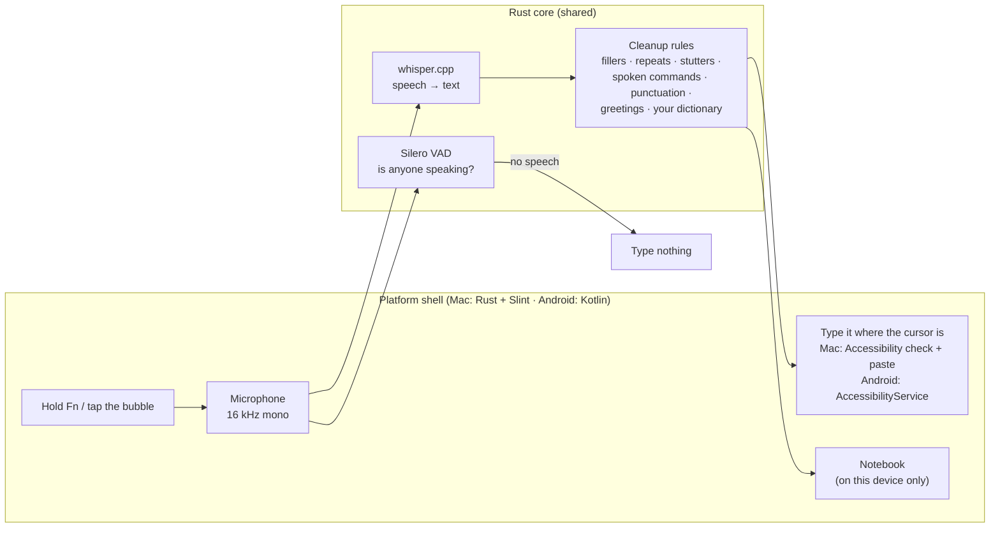
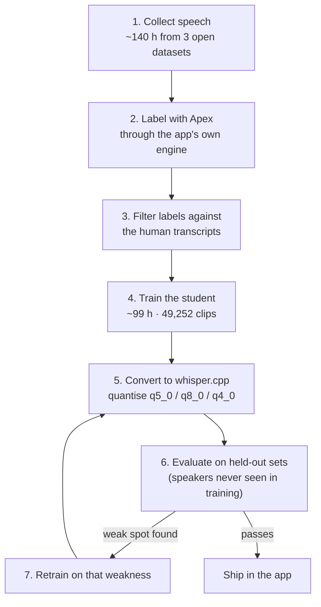

# Bolkey for Mac

**Speak. It's typed.** Hold **Fn**, speak Hindi, English or Hinglish, and it types where your cursor is. Hinglish comes out in Roman letters. Everything runs on your Mac: it works offline and your voice never leaves the computer.

**Download page:** https://shubhamsingh047.github.io/voice-dictation-app/

| Version | Download | Best for |
|---|---|---|
| Bolkey | [Bolkey-0.2.4-macOS-arm64.dmg](https://github.com/ShubhamSingh047/voice-dictation-app/releases/download/v0.2.4/Bolkey-0.2.4-macOS-arm64.dmg) (523 MB) | Highest accuracy (recommended), blue |
| Bolkey Lite | [Bolkey-Lite-0.2.4-macOS-arm64.dmg](https://github.com/ShubhamSingh047/voice-dictation-app/releases/download/v0.2.4/Bolkey-Lite-0.2.4-macOS-arm64.dmg) (62 MB) | Smallest and fastest, orange; weaker on English |

Requires a Mac with Apple Silicon (M1 or newer) and macOS 11 or later.

## Install

1. Open the `.dmg` and drag Bolkey onto **Applications**.
2. Open it. This preview is not notarized, so macOS blocks the first launch. Go to **System Settings → Privacy & Security** and click **Open Anyway**.
3. Allow **Accessibility** and **Microphone** when asked.
4. If Fn opens the emoji picker, set **System Settings → Keyboard → "Press 🌐 key to"** to **Do Nothing**.

## Use

- Hold **Fn**, speak, release: the text is typed.
- Double-tap **Fn**: hands-free; press Fn or ■ to finish.
- **Esc** or ✕: cancel.
- Menu-bar keycap icon: language, pill position, free memory after, launch at login, notes, quit.

## How it works

One Rust core does the listening, and each platform wraps it in a thin native shell: Slint on the Mac, and Kotlin on Android through UniFFI bindings. There is no server and no account. The Android app does not even ask for network permission.

- **Speech check and transcription run side by side.** Silero VAD runs on one thread while whisper.cpp transcribes. If the check finds no speech, nothing is typed, so silence never turns into made-up words.
- **The encoder window fits the clip.** Whisper normally encodes a fixed 30 s of audio. Bolkey sizes the window to what you actually said. On the Mac, Apex keeps a floor of about 7.7 s, and a 2 to 5 s clip went from about 2.8 s to about 0.22 s.
- **Cleanup is plain rules, not a second AI model.** They remove "um/uh", loops and stutters, apply spoken commands like "new line", fix punctuation, and repair known mishearings, for example "Yah WhatsApp." back to "Hey what's up."
- **It only types into a text field.** On the Mac, Bolkey asks Accessibility whether the cursor is in a field. If yes, it pastes and then restores your clipboard. If no, the text goes to the Notebook.

## How the models were built

Two editions ship, built from two models:

| | Bolkey (Apex) | Bolkey Lite (student) |
|---|---|---|
| Base | [Oriserve Whisper-Hindi2Hinglish-Apex](https://huggingface.co/Oriserve/Whisper-Hindi2Hinglish-Apex) (whisper-large-v3-turbo, 809M parameters) | Oriserve Swift (whisper-base, 74M), fine-tuned by us on Apex's output |
| Size on disk | 574 MB (q5_0) | 55 MB (q5_0, Mac) · 82 MB (q8_0, Android) |
| Runs on | Mac GPU (Metal) | Mac GPU · phone CPU |

No public dataset has Hindi and Hinglish speech written in **Roman letters**, which is how people actually type Hinglish. So we made one: the big model labels the audio, and the small model learns from those labels. This is called distillation by pseudo-labelling, the method behind Distil-Whisper.

### 1. Data

| Dataset | Used for | Size | Licence |
|---|---|---|---|
| [MUCS 2021 Hindi-English](https://www.openslr.org/104/) (OpenSLR 104) | Training (code-switched Hinglish) | 52,769 clips · 89 h | CC BY-SA 4.0 |
| MUCS test | Testing Hinglish | 3,132 clips · 5.1 h | CC BY-SA 4.0 |
| [IndicVoices](https://huggingface.co/datasets/ai4bharat/IndicVoices) Hindi (AI4Bharat) | Training (pure Hindi), balanced by gender and schooling | 18,704 clips · 40 h | CC BY 4.0 |
| IndicVoices held-out shard | Testing Hindi | 199 clips | CC BY 4.0 |
| [LibriSpeech](https://www.openslr.org/12/) train-clean-100 | Training (keeps English from fading) | 2,763 clips · 10 h | CC BY 4.0 |
| [Svarah](https://github.com/AI4Bharat/Svarah) (AI4Bharat) | Testing Indian-accented English | 300 clips | CC BY 4.0 |

All audio is converted to 16 kHz mono, at most 30 s per clip. **Any speaker who appears in a test set is removed from training**, so the scores measure voices the model has never heard.

### 2. Labels and filtering

Apex transcribed every training clip through the same engine the app uses: 52,693 MUCS clips, 18,688 IndicVoices clips and 2,763 LibriSpeech clips. A label is kept only if it agrees with the human transcript:

- **English references:** word error rate ≤ 10 %.
- **Devanagari references:** "skeleton" character error ≤ 20 %. The threshold was tuned by hand on 40 pairs. A skeleton turns Devanagari and Roman text into the same consonant shape, so `कल की मीटिंग` and `kal ki meeting` both become `klkmtng`. That lets a Roman-letter label be checked against a Devanagari reference.
- **Loop guard:** labels much longer than the reference are dropped, since that is how Whisper hallucinations look.

Share of labels kept: MUCS 66 %, IndicVoices 76 %, LibriSpeech 86 %. Final training set: **49,252 clips (~99 h)** plus 766 for validation.

### 3. Training

- **Hardware:** a 16 GB MacBook Air (M4) on Apple's MPS GPU backend. Nothing ran in the cloud.
- **Settings:** learning rate 1e-5, 32 clips per step, 5,000 steps, 13 h 51 m.
- **Bug fixed during training:** a wrong special-token id in the base model's config. Fixing it dropped the first-batch loss from 3.42 to 0.19.
- **Checkpoint kept:** step 3000 scored best on the held-out sets, so that is the one we kept.

### 4. Evaluation

**Metrics:** word error rate for English; skeleton character error rate for Hindi and Hinglish, so Roman and Devanagari spellings of the same words count as the same. Lower is better, and each clip is capped at 100 %.

| Model (full 30 s window) | Hinglish (MUCS) | Hindi (IndicVoices) | Indian English (Svarah) |
|---|---|---|---|
| Apex (Bolkey) | 34.0 | **10.0** | **23.0** |
| Swift (student's starting point) | 34.0 | 13.5 | 27.2 |
| **Student v1 (Bolkey Lite)** | 34.1 | 12.8 | 28.4 |

- **What distillation gained:** Lite matches Apex on Hinglish and moved toward it on Hindi (13.5 → 12.8).
- **Where Lite trails:** English, by about 5 points. That is why Bolkey (Apex) stays the recommended edition.
- **Why Hinglish errors look high for every model:** MUCS's human references mix scripts and spellings, so all three models score about 34 % there.

### 5. Making it fast on phones, then retesting

A phone has no Mac-class GPU, so the student had to run on the CPU. Every speed change below was retested for accuracy before it was kept. Times are on an Oppo Find X8 (Dimensity 9400) for a 3.3 s clip:

| Change | Speech-to-text time | Accuracy (Hindi / English) |
|---|---|---|
| Generic ARM build | 2.7 s | 12.6 / 28.7 |
| Build for ARM dot-product instructions | 1.55 s | same |
| Thread count = cores − 2 (2 to 6), so other apps stay smooth | ~1.3 s | same |
| 20 s encoder window instead of 30 s | 0.82 s | 12.9 / 29.7 |
| q8_0 quantisation (q5_0 has no fast ARM kernel) | 0.46 s | 12.8 / 30.7 |
| i8mm build, picked at runtime when the CPU supports it | **0.43 s** | same |

- **Rejected:** a phone GPU (Vulkan) build. It was slower on the Mali GPU (2.1 s vs 1.25 s), so it was not shipped.
- **Rejected:** a smaller encoder window. Below 20 s, accuracy fell quickly: 15.7 / 33.0 at 10 s.
- **Long dictations:** speech is cut at natural pauses after 15 s and transcribed while you keep talking. A 45 s dictation went from 6.2 s to 1.3 s after release.

**Retraining now:** the student learned only on full 30 s windows, so it degrades when the window shrinks. We are retraining it on random 10, 15, 20 and 30 s windows so phones can use smaller, faster windows without losing accuracy.

### Speed

From releasing the key to the text appearing. The target was to beat Wispr Flow's ~0.7 s.

| Device | Bolkey (Apex) | Bolkey Lite |
|---|---|---|
| MacBook Air M4 | 0.41–0.65 s | 0.18–0.25 s |
| Oppo Find X8 (Android) | — | 0.43–0.52 s |

## This repository

This repository holds the download page and releases. Licences and credits: [THIRD_PARTY_NOTICES.md](THIRD_PARTY_NOTICES.md).
