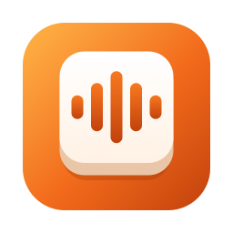
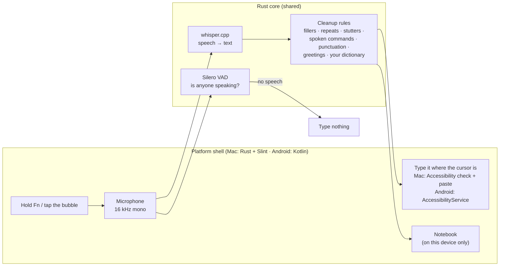
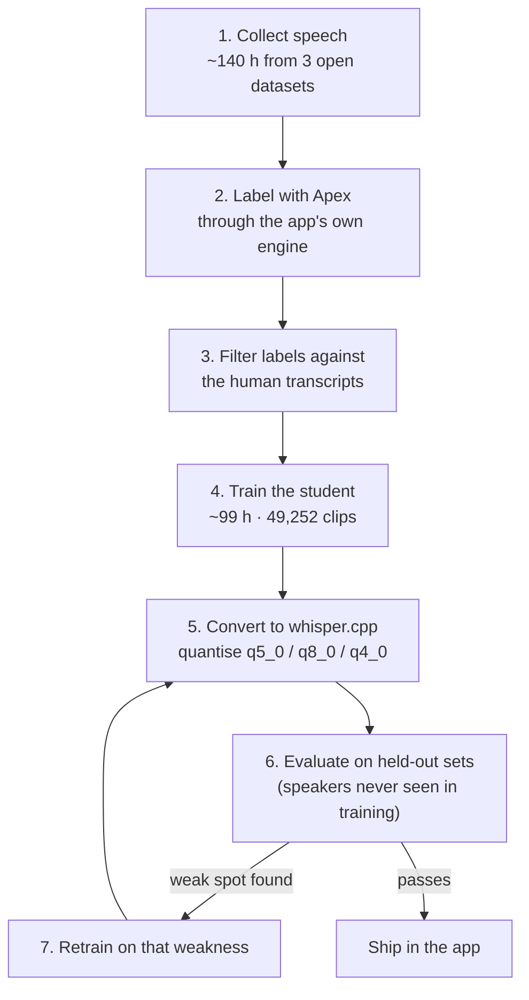

# Bolkey for Mac and Android

**Speak. It's typed.** Hold **Fn**, speak Hindi, English or Hinglish, and it types where your cursor is. Hinglish comes out in Roman letters. Everything runs on your Mac: it works offline and your voice never leaves the computer.

**Download page:** https://shubhamsingh047.github.io/voice-dictation-app/

| Version | Download | Best for |
|---|---|---|
| Bolkey Lite for Mac | [Bolkey-Lite-0.2.7-macOS-arm64.dmg](https://github.com/ShubhamSingh047/voice-dictation-app/releases/download/v0.2.7/Bolkey-Lite-0.2.7-macOS-arm64.dmg) (64 MB) | Hold Fn and speak; Apple Silicon, macOS 11+ |
| Bolkey Lite for Android | [Bolkey-Lite-0.2.7-android-arm64.apk](https://github.com/ShubhamSingh047/voice-dictation-app/releases/download/v0.2.7/Bolkey-Lite-0.2.7-android-arm64.apk) (98 MB) | Android 10 or later; a floating bubble types into any app |
| Bolkey Lite for Windows | [Bolkey-Lite-0.2.7-windows-x64-setup.exe](https://github.com/ShubhamSingh047/voice-dictation-app/releases/download/v0.2.7/Bolkey-Lite-0.2.7-windows-x64-setup.exe) | Windows 10 or 11, first preview; hold Ctrl + Win |

Mac: Apple Silicon (M1 or newer), macOS 11 or later. Android: 64-bit ARM phones, Android 10 or later. Install steps for Android are on the [download page](https://shubhamsingh047.github.io/voice-dictation-app/).

## Install

1. Open the `.dmg` and drag Bolkey onto **Applications**.
2. Open it. This preview is not notarized, so macOS blocks the first launch. Go to **System Settings → Privacy & Security** and click **Open Anyway**.
3. Allow **Accessibility** and **Microphone** when asked.
4. If Fn opens the emoji picker, set **System Settings → Keyboard → "Press 🌐 key to"** to **Do Nothing**.

## Use

- Hold **Fn**, speak, release: the text is typed.
- Double-tap **Fn**: hands-free; press Fn or ■ to finish.
- **Esc** or ✕: cancel.
- Menu-bar keycap icon: language, pill position, free memory after, launch at login, notes, quit.

## How it works

One Rust core does the listening, and each platform wraps it in a thin native shell: Slint on the Mac and Windows, and Kotlin on Android through UniFFI bindings. There is no server and no account. The only network request is a once-a-day check for a newer version number (Settings → Check for updates); speech and text never leave the device.

- **Speech check and transcription run side by side.** Silero VAD runs on one thread while whisper.cpp transcribes. If the check finds no speech, nothing is typed, so silence never turns into made-up words.
- **The encoder window fits the clip.** Whisper normally encodes a fixed 30 s of audio. Bolkey sizes the window to what you actually said. On the Mac, Apex keeps a floor of about 7.7 s, and a 2 to 5 s clip went from about 2.8 s to about 0.22 s.
- **Cleanup is plain rules, not a second AI model.** They remove "um/uh", loops and stutters, apply spoken commands like "new line", fix punctuation, and repair known mishearings, for example "Yah WhatsApp." back to "Hey what's up."
- **It only types into a text field.** On the Mac, Bolkey asks Accessibility whether the cursor is in a field. If yes, it pastes and then restores your clipboard. If no, the text goes to the Notebook.

## How the models were built

Two editions ship, built from two models:

| | Bolkey (Apex) | Bolkey Lite (student) |
|---|---|---|
| Base | [Oriserve Whisper-Hindi2Hinglish-Apex](https://huggingface.co/Oriserve/Whisper-Hindi2Hinglish-Apex) (whisper-large-v3-turbo, 809M parameters) | Oriserve Swift (whisper-base, 74M), fine-tuned by us on Apex's output |
| Size on disk | 574 MB (q5_0) | 55 MB (q5_0, Mac: v1) · 82 MB (q8_0, Android: v2) |
| Runs on | Mac GPU (Metal) | Mac GPU · phone CPU |

No public dataset has Hindi and Hinglish speech written in **Roman letters**, which is how people actually type Hinglish. So we made one: the big model labels the audio, and the small model learns from those labels. This is called distillation by pseudo-labelling, the method behind Distil-Whisper.

### 1. Data

| Dataset | Used for | Size | Licence |
|---|---|---|---|
| [MUCS 2021 Hindi-English](https://www.openslr.org/104/) (OpenSLR 104) | Training (code-switched Hinglish) | 52,769 clips · 89 h | CC BY-SA 4.0 |
| MUCS test | Testing Hinglish | 3,132 clips · 5.1 h | CC BY-SA 4.0 |
| [IndicVoices](https://huggingface.co/datasets/ai4bharat/IndicVoices) Hindi (AI4Bharat) | Training (pure Hindi), balanced by gender and schooling | 18,704 clips · 40 h | CC BY 4.0 |
| IndicVoices held-out shard | Testing Hindi | 199 clips | CC BY 4.0 |
| [LibriSpeech](https://www.openslr.org/12/) train-clean-100 | Training (keeps English from fading) | 2,763 clips · 10 h | CC BY 4.0 |
| [Svarah](https://github.com/AI4Bharat/Svarah) (AI4Bharat) | Testing Indian-accented English | 300 clips | CC BY 4.0 |

All audio is converted to 16 kHz mono, at most 30 s per clip. **Any speaker who appears in a test set is removed from training**, so the scores measure voices the model has never heard.

### 2. Labels and filtering

Apex transcribed every training clip through the same engine the app uses: 52,693 MUCS clips, 18,688 IndicVoices clips and 2,763 LibriSpeech clips. A label is kept only if it agrees with the human transcript:

- **English references:** word error rate ≤ 10 %.
- **Devanagari references:** "skeleton" character error ≤ 20 %. The threshold was tuned by hand on 40 pairs. A skeleton turns Devanagari and Roman text into the same consonant shape, so `कल की मीटिंग` and `kal ki meeting` both become `klkmtng`. That lets a Roman-letter label be checked against a Devanagari reference.
- **Loop guard:** labels much longer than the reference are dropped, since that is how Whisper hallucinations look.

Share of labels kept: MUCS 66 %, IndicVoices 76 %, LibriSpeech 86 %. Final training set: **49,252 clips (~99 h)** plus 766 for validation.

### 3. Fine-tuning

Everything (labelling, both fine-tuning runs and every test) ran on one laptop: a **MacBook Air M4 with 16 GB of RAM**, using its GPU (Metal for whisper.cpp, PyTorch MPS for training). There was no cloud GPU and no rented hardware.

| Stage | What ran | When | Time |
|---|---|---|---|
| Download and prepare audio | ~140 h from 4 datasets → 16 kHz FLAC | 15 Oct, from 00:40 | ~1.5 h (overlaps labelling) |
| Label the training audio with Apex | 74,236 clips through the app's own engine | 15 Oct 01:16 → 12:00 | **10 h 44 min** |
| Filter labels, build sets, memory fix | calibrate the filters, fix the out-of-memory crash, throughput test | 15 Oct 12:00 → 13:50 | ~2 h |
| Fine-tune 1: distillation | Swift → student v1 · 5,000 steps × 32 clips (about 3 passes over the data) | 15 Oct 13:52 → 16 Oct 03:43 | **13 h 51 min** |
| Convert and test | whisper.cpp conversion, 3 held-out sets (~3,600 clips) | 16 Oct 03:44 → 05:00 | ~1.3 h |
| **First model, start to finish** | | | **about 28 hours** |
| Fine-tune 2: short windows | student v1 → v2 · 1,500 steps × 32 clips (resumed once after a disk failure) | 17 Oct | **about 3.7 h** |

- **Fine-tune 1 settings:** learning rate 1e-5, batch 4 × gradient accumulation 8, keep the checkpoint that scores best on held-out data. Step 3000 won.
- **Bug fixed:** a wrong special-token id in the base model's config. Fixing it dropped the first-batch loss from 3.42 to 0.19.
- **Fitting in 16 GB:** training first crashed with an MPS out-of-memory error. Every new label length made the GPU cache new buffers. Padding labels to multiples of 64 kept memory flat at 7 to 8 GB.
- **A fanless laptop:** steps slowed from about 8 s to 10 s as the MacBook Air heated up. We planned around that rather than renting a GPU.
- **Crash-safe:** checkpoints are saved every 500 steps. When the Mac froze during fine-tune 2, training resumed from the last checkpoint and lost only about 45 minutes.

### 4. Evaluation

**Metrics:** word error rate for English; skeleton character error rate for Hindi and Hinglish, so Roman and Devanagari spellings of the same words count as the same. Lower is better, and each clip is capped at 100 %.

| Model (full 30 s window) | Hinglish (MUCS) | Hindi (IndicVoices) | Indian English (Svarah) |
|---|---|---|---|
| Apex (Bolkey) | 34.0 | **10.0** | **23.0** |
| Swift (student's starting point) | 34.0 | 13.5 | 27.2 |
| **Student v1 (Bolkey Lite)** | 34.1 | 12.8 | 28.4 |

- **What distillation gained:** Lite matches Apex on Hinglish and moved toward it on Hindi (13.5 → 12.8).
- **Where Lite trails:** English, by about 5 points. That is why Bolkey (Apex) stays the recommended edition.
- **Why Hinglish errors look high for every model:** MUCS's human references mix scripts and spellings, so all three models score about 34 % there.

### 5. Making it fast on phones, then retesting

A phone has no Mac-class GPU, so the student had to run on the CPU. Every speed change below was retested for accuracy before it was kept. Times are on an Oppo Find X8 (Dimensity 9400) for a 3.3 s clip:

| Change | Speech-to-text time | Accuracy (Hindi / English) |
|---|---|---|
| Generic ARM build | 2.7 s | 12.6 / 28.7 |
| Build for ARM dot-product instructions | 1.55 s | same |
| Thread count = cores − 2 (2 to 6), so other apps stay smooth | ~1.3 s | same |
| 20 s encoder window instead of 30 s | 0.82 s | 12.9 / 29.7 |
| q8_0 quantisation (q5_0 has no fast ARM kernel) | 0.46 s | 12.8 / 30.7 |
| i8mm build, picked at runtime when the CPU supports it | 0.43 s | same |
| **Student v2 (fine-tune 2) at a 10 s window** | **0.21–0.28 s** | 13.1 / 30.6 |

- **Rejected:** a phone GPU (Vulkan) build. It was slower on the Mali GPU (2.1 s vs 1.25 s), so it was not shipped.
- **Rejected:** a smaller encoder window. Below 20 s, accuracy fell quickly: 15.7 / 33.0 at 10 s.
- **Long dictations:** speech is cut at natural pauses after 15 s and transcribed while you keep talking. A 45 s dictation went from 6.2 s to 1.3 s after release.

**Fine-tune 2: retraining for short windows.** Student v1 only ever saw full 30 s windows, so it fell apart when phones shrank the window (16.9 / 32.6 at 10 s). We fine-tuned it again on random 10, 15, 20 and 30 s windows. The result, student v2, at a **10 s** window scores what v1 scored at 20 s, with half the encoder work:

| Phone model (q8_0) | 20 s window | 15 s | 10 s |
|---|---|---|---|
| Student v1 | 12.8 / 30.7 | — | 16.9 / 32.6 |
| **Student v2** | **12.2 / 29.1** | 12.5 / 30.1 | **13.1 / 30.6** |

Android now ships v2 at a 10 s window. The Mac keeps v1: Macs use the full window, where v2 is no better (12.6 / 29.1 vs 12.6 / 28.7).

### 6. Fine-tune 3: one real speaker's voice (Lite v3)

Public test sets say little about how the app works for the person actually using it, so the developer recorded their own voice: **212 short sentences**, read at normal speed in a quiet room on the Mac's microphone. They cover Hinglish, English, Hindi and short replies, plus three sets aimed at problems they kept hitting: words with **p and b**, **acronyms** (GTM, MVP, API, AWS, UPI…) and **fast speech**. Every third sentence of each kind (67) was held out and never trained on; all the scores below are on those.

- **Mix:** the developer's 145 training clips, each repeated 8 times, plus 2,800 public clips (Hindi-English tutorials from MUCS and English from LibriSpeech) so the model keeps working for everyone else.
- **Rule for shipping:** no more than 0.5 points worse on the public Hindi and Indian English tests than the model it replaces.
- **Device and time:** the same MacBook Air M4; each 200-step round took about 25 minutes, and scoring about 10.

What happened, round by round:

1. **Fine-tuning the student (v2) on the developer's voice** helped them (31.6 → about 28 %) but cost other speakers up to 0.8 points on Indian English. Adding English to the mix didn't fix that.
2. **Weight averaging** (half the fine-tuned weights, half the original) kept most of that gain and none of the loss.
3. **Swift, the student's own starting point, beat every student** on the developer's voice and on Indian English. So the last round fine-tuned Swift instead, then averaged it 50/50 with Swift. That is **Lite v3**.

| Model, at the phone's 10 s window (q8_0) | Developer's voice | Acronyms | Fast speech | Hindi (IndicVoices) | Indian English (Svarah) |
|---|---|---|---|---|---|
| Student v2 (0.2.5) | 31.6 | 34.3 | 16.9 | **13.1** | 30.6 |
| Student v2 + developer's voice, averaged | 28.8 | 27.3 | 15.8 | **13.1** | 29.4 |
| Swift | 26.2 | 21.0 | 17.0 | 13.7 | 28.0 |
| **Lite v3** (Swift + developer's voice, averaged) | **24.5** | **16.5** | **10.6** | 13.7 | **26.5** |

On the Mac (full window, q5_0) Lite v3 scores 25.0 on the developer's voice against 30.8 for the old Lite (v1), with Hindi 13.1 vs 12.6 and Indian English 27.9 vs 28.7. Both apps ship Lite v3 from 0.2.6. The recordings themselves stay on the developer's Mac; only the trained model is published.

**Bolkey vs Bolkey Lite in 0.2.6.** Scored the same way, with the apps' own settings (English and Hinglish mode, Roman letters). These runs differ from section 4's setup, so compare numbers within this table only.

| Mac, full window | Bolkey (Apex) | Bolkey Lite (v3) |
|---|---|---|
| Hindi (IndicVoices) | 13.8 | **13.1** |
| Indian English (Svarah) | **26.7** | 27.9 |
| Developer's held-out sentences | 24.8 | 25.0 |
| Acronyms / fast speech (developer) | 17.9 / 16.0 | **14.4 / 12.5** |
| Text after release, MacBook Air M4 | 0.41–0.65 s | **0.18–0.25 s** |
| Download | 524 MB | **64 MB** |

On speakers neither model was trained on, Lite is 0.7 points better on Hindi and 1.2 points behind on Indian English, so Lite is now the recommended download.

**"My words."** Both apps take a list of words, one per line: `GTM` keeps that exact spelling, and `MBP => MVP` fixes a word the model mishears. We also tried giving the list to the model as a hint (Whisper's initial prompt). It helped student v2 (acronyms 34.7 → 24.4 %) but made Lite v3 worse (24.5 → 26.2 %, mostly on Hinglish), so the list only corrects the finished text.

### Speed

From releasing the key to the text appearing. The target was to beat Wispr Flow's ~0.7 s.

| Device | Bolkey (Apex) | Bolkey Lite |
|---|---|---|
| MacBook Air M4 | 0.41–0.65 s | 0.18–0.25 s |
| Oppo Find X8 (Android) | — | 0.84–0.99 s for a 45 s dictation (speech-to-text 0.21–0.28 s for a short one); Lite v3 is the same size and speed |

## This repository

This repository holds the download page and releases. Licences and credits: [THIRD_PARTY_NOTICES.md](THIRD_PARTY_NOTICES.md).
